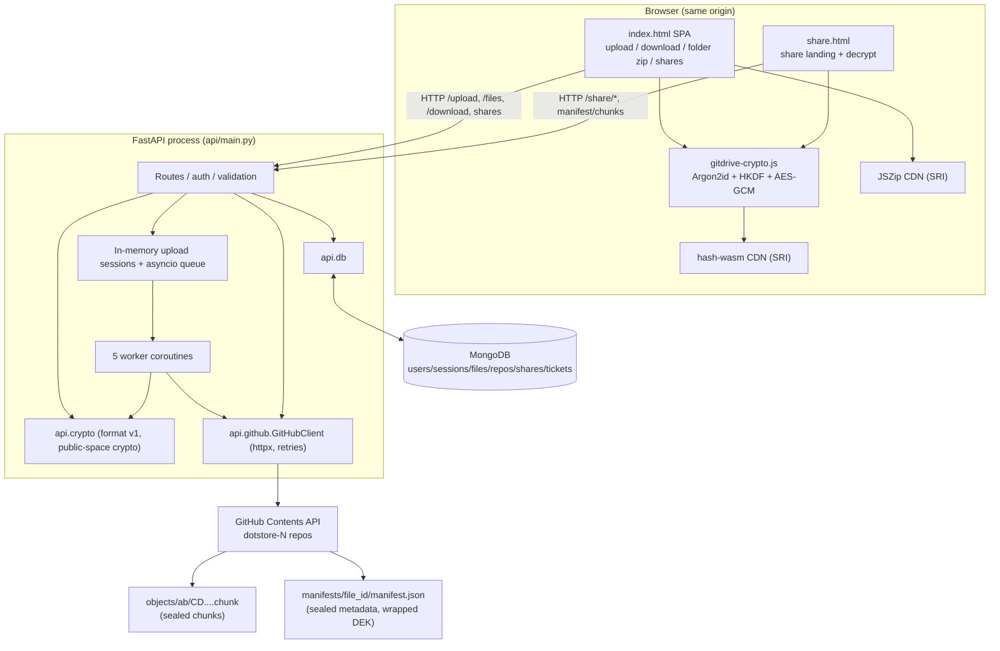

# GitDrive — Comprehensive Repository Audit & Architecture Documentation

**Document type:** reverse-engineered, evidence-based audit of the GitDrive repository
**Audit date:** 2026-10-15
**Method:** static source inspection of the entire application-owned codebase, plus one non-destructive execution of the existing Python test suite (results recorded in §15). No application code was modified. No dependencies were installed. No external service was contacted (the test suite stubs MongoDB and GitHub by design).

**Repository state audited:** branch `feature/users`, commit `a750fdd` ("bug fixes and share.html", 2026-09-30) **plus a large uncommitted working tree** that contains the current crypto format rework (`api/crypto.py`, `gitdrive-crypto.js`, `tests/` are untracked; `api/main.py`, `api/db.py`, `index.html`, `share.html`, `README.md`, `.gitignore` are modified). This audit documents the **working tree as found**, because that is what the code actually does today. Where the committed baseline differs meaningfully, it is noted.

---

## 1. Executive Summary

GitDrive is a self-hosted "cloud drive" that uses **GitHub repositories as its blob store** and **MongoDB only for metadata**. A single FastAPI process serves a browser SPA (`index.html`), a dedicated share landing page (`share.html`) and a shared browser crypto module (`gitdrive-crypto.js`). Files are chunked (10 MB) by the browser, uploaded over `/upload` into a disk-backed producer–consumer pipeline, and written to GitHub by five background workers as individually sealed AES-256-GCM objects under `objects/<sha256-prefixed path>` plus one JSON manifest per file under `manifests/<file_id>/manifest.json`.

The project's distinguishing feature is **two encryption spaces implemented on one on-disk format** (`api/crypto.py`, format version 1):

- **Private space (zero-knowledge):** the browser runs Argon2id (64 MiB, t=3, p=1) over the user password to obtain `K_root`, derives a per-file KEK via HKDF-SHA256 with the file id as salt, unwraps a random per-file DEK, and encrypts every chunk with a **per-chunk HKDF-derived key** before upload. The server only ever receives ciphertext, an opaque manifest, and a password-derived *verifier* (`HMAC(K_auth, "gitdrive-auth-v1")`, stored only as SHA-256). Decryption happens entirely in the browser, or offline by a future CLI reading the manifest and chunks directly from GitHub — `api/crypto.py` imports nothing from FastAPI/Mongo/GitHub for exactly that reason.
- **Public space (server-controlled):** the browser uploads plaintext; the server encrypts with keys derived from the required `GITDRIVE_MASTER_KEY`, so a raw GitHub blob is useless without that key, and the master key is independent of `GITHUB_TOKEN`.

Status at audit time: the core backend, crypto format, auth, upload pipeline, public download streaming, private manifest/chunk delivery, and share-link/ticket flows are **implemented and covered by a stubbed end-to-end test suite that passed 44/44 tests (3 JS-in-browser layers skipped because `hash-wasm` is not vendored in this checkout)**. There is **no delete/update endpoint, no password change/recovery, no session expiry, no CI, and no in-repo evidence of a live deployment**. The repo contains a Dockerfile and a Hugging Face Space mirror remote (deployment status unverified).

---

## 2. Project Purpose and Scope

- **One-sentence description (from source, not marketing):** GitDrive stores chunked, optionally end-to-end-encrypted files in GitHub repositories (via the GitHub Contents API) with MongoDB metadata, exposes them through a FastAPI HTTP API and a browser SPA, and lets private files be decrypted either in the browser or from the GitHub repository alone using the password and the published manifest format.
- **What problem it addresses (as evidenced by the code):** using a free, ubiquitous storage provider (GitHub repos) as a personal drive while (a) keeping private files unreadable to both the server and anyone with repository access, and (b) keeping server RAM bounded during uploads regardless of file size or concurrency (the producer–consumer pipeline, `api/main.py:358-364`).
- **Scope of this audit:** everything in the repository root except `.git/`, `.venv/`, `api/__pycache__/`, and the generated lock/vector files listed in §3. Tracked files: 12. Application-owned files inspected individually: 22 (4 Python modules, 2 HTML apps, 1 JS crypto module, 8 test/probe files, 5 config/doc files). No git history archaeology beyond `git log`/`git diff` summaries used for context; no secrets from `.env` are reproduced anywhere in this document.

---

## 3. Repository Structure

```
gitdrive/
├── api/
│   ├── main.py            # FastAPI app: routes, sessions, upload queue/workers, streaming, shares (748 lines)
│   ├── crypto.py          # Reference implementation of the GitDrive crypto format v1 (275 lines) [untracked]
│   ├── db.py              # MongoDB access layer, indexes, users/sessions/files/shares/tickets (203 lines)
│   └── github.py          # GitHub Contents API client with retry/pooling/conflict handling (123 lines)
├── tests/
│   ├── conftest.py        # FakeDB/FakeGitHub doubles + app factory; installs fake api.db before import (221 lines)
│   ├── test_gitdrive.py   # End-to-end tests for both encryption spaces + integrity + server secrets + schema (453 lines)
│   ├── test_smoke.py      # A single full browser-equivalent journey through the served pages (138 lines)
│   ├── test_vectors.py    # Cross-implementation vectors: Python always; JS layers when hash-wasm available (145 lines)
│   ├── test_js_e2e.py     # Boots real uvicorn on a free port and runs js_e2e.js against it (83 lines)
│   ├── make_vectors.py    # Deterministic vector generator pinning the byte format (72 lines)
│   ├── js_vectors.js      # Node harness: gitdrive-crypto.js must reproduce the Python vectors (112 lines)
│   ├── js_e2e.js          # Node harness: browser code path against a live HTTP server (186 lines)
│   ├── vectors.json       # Generated test vectors (gitignored, present in working tree)
│   └── js_manifest.json   # Generated by js_vectors.js when run (gitignored, not present at audit time)
├── index.html             # Full browser SPA: auth, upload, download, folder zip, shares, themes (2273 lines)
├── share.html             # Share landing page: unlock/decrypt private files, redirect public downloads (485 lines)
├── gitdrive-crypto.js     # Browser half of the crypto format (Web Crypto + hash-wasm), window.GDCrypto (255 lines) [untracked]
├── api/main.py served assets: index.html, share.html, gitdrive-crypto.js read from repo root at request time
├── Dockerfile             # uv-based image, uvicorn on port 10000
├── pyproject.toml         # project metadata + 7 dependencies, Python >= 3.13
├── uv.lock                # generated lockfile (118 KB) — excluded from per-file analysis (generated)
├── .python-version        # "3.13"
├── .env                   # local dev secrets/config — NOT tracked (ignored); keys only listed in §13
├── .gitignore             # ignores .venv, .env, __pycache__, tests/vectors.json, tests/js_manifest.json, node_modules
├── LICENSE                # MIT, Copyright (c) 2026 Prajwal M M
├── README.md              # architecture notes, endpoint table, self-hosting guide, known limitations (124 lines)
└── .agents/               # empty directory (no content at audit time)
```

**Excluded from per-file analysis (generated / environment / tooling):**
- `.venv/` — local virtual environment (Python 3.13.14, dependencies installed).
- `api/__pycache__/*.pyc` — bytecode caches.
- `uv.lock` — generated dependency lockfile; only its existence is evidence for "uv" as the dependency workflow.
- `tests/vectors.json` — generated by `tests/make_vectors.py` / `tests/js_vectors.js` (gitignored; present locally).
- `.git/` — history internals.

**Git metadata (context only):** branches `main`, `feature/users`, `ui-redesign`; HEAD of `feature/users` is `a750fdd`; remotes: a GitHub origin and a Hugging Face Spaces mirror. Version `3.5.0` in both `pyproject.toml` and the FastAPI app. The `feature/users` working tree is the "zero-knowledge rework": `git diff` against HEAD shows `api/main.py` +471/-, `index.html` +679/-, `share.html`, `api/db.py`, `README.md`, `.gitignore` all modified, and the crypto module/auth rework added untracked. Older committed code (visible in the diff) used server-side per-user encryption keys (`encryption_id`), password hashes, and hash-of-content deduplication (`sha256` as the file key); the working tree replaces all three.

---

## 4. Technology Stack and Dependencies

Declared dependencies come from `pyproject.toml:6-13`; usage claims below were verified by reading imports and call sites.

| Technology | Role | Evidence / where used |
|---|---|---|
| Python **3.13** (`.python-version`, `requires-python = ">=3.13"`) | Server runtime | `pyproject.toml:5`, `Dockerfile:1` uses python3.13-slim base |
| **FastAPI** ≥0.115 | HTTP API, form/multipart parsing, dependency injection, lifespan | `api/main.py:16,250`; routes throughout |
| **Uvicorn** [standard] ≥0.30 | ASGI server | `Dockerfile:14`, README self-host command, `tests/test_js_e2e.py:42` |
| **httpx** ≥0.27 | GitHub Contents API HTTP client (pooled, timeouts, retries) | `api/github.py:5,29-56,116-123` |
| **python-multipart** ≥0.0.12 | multipart/form-data parsing for `/upload`, `/auth/*` | required by FastAPI form endpoints (`api/main.py:367-384`) |
| **python-dotenv** ≥1.0 | `.env` loading | `api/main.py:15,22`, `api/db.py:6,8`, `api/github.py:5,8` |
| **pymongo** ≥4.10 | MongoDB driver (metadata only) | `api/db.py:4,18-25` |
| **cryptography** ≥49.0.0 | Argon2id, AES-GCM, HKDF, HMAC primitives in the reference crypto module | `api/crypto.py:22-26` |
| **MongoDB** (external) | users, sessions, files metadata, repos accounting, shares, tickets | `api/db.py` collections `:20-25` |
| **GitHub Contents API** (external REST) | Blob storage: encrypted chunk objects + per-file manifests | `api/github.py:10,78-123` |
| **Web Crypto API** (browser platform) | HKDF-SHA256, HMAC-SHA256, AES-256-GCM, SHA-256, getRandomValues | `gitdrive-crypto.js:77-211` |
| **hash-wasm 4.12.0** (CDN, SRI-pinned) | Argon2id in the browser (the only primitive Web Crypto lacks) | `index.html:21-23`, `share.html:213-215`; `tests/js_vectors.js` loads the same module under Node |
| **JSZip 3.10.1** (CDN, SRI-pinned) | Client-side folder→zip download | `index.html:17-19`, used at `index.html:1546,1563` |
| **unittest** (stdlib) | All Python tests; no pytest anywhere | `tests/*.py` |
| **Node.js** (test-time only) | Runs `js_vectors.js` / `js_e2e.js`; skipped when absent | `tests/test_vectors.py:23`, `tests/test_js_e2e.py:22` |
| **uv** | Dependency management and Docker build | `uv.lock`, `Dockerfile:1,6`, README |
| **Docker** | Containerized deployment config | `Dockerfile` |

Not present (verified absent): any ORM, Alembic/migration tool, Redis/Celery, pytest, Playwright/Selenium, any CI configuration (`.github/` does not exist), `.dockerignore`, CORS middleware, or rate-limiting library.

---

## 5. High-Level Architecture

**Architectural style:** a single-process, stateless-except-for-in-memory-upload-sessions FastAPI application ("monolith"), with:
- **Server-side rendering of static HTML** — `GET /` reads `index.html` from disk and returns it (`api/main.py:344-346`); `GET /gitdrive-crypto.js` likewise (`:352-356`); the share page template `share.html` is injected with a JSON payload (`:700-724`). There is no build step and no static-file middleware.
- **A disk-backed producer–consumer upload pipeline** (in-process asyncio queue + 5 worker tasks, `api/main.py:47,200-233,236-249,358-364`).
- **A content-addressed blob store that is not a filesystem** — GitHub repositories, one repo per ~5 GiB (`api/db.py:10,47-63`; `api/main.py:404-409`).
- **A crypto boundary drawn at the browser for private files and at the server for public files** (`api/main.py:398-466`; `gitdrive-crypto.js`; `index.html:1884-2032`).

**Main components and responsibilities:**

1. **Browser SPA (`index.html`)** — auth UI (register/login), Argon2id key derivation, private upload encryption planning (`privateUploadPlan`, `:1884-1916`), chunked XHR upload with progress (`upload`, `:1963-2088`), sync polling (`pollSync`, `:2090-2135`), public streaming download (`downloadPublic`, `:2146-2160`), private decrypt download (`downloadPrivate`, `:2164-2205`), folder traversal + JSZip (`:1839-1878,1537-1571`), share link creation (`shareFile`, `:1611-1623`), file list/search/folders UI.
2. **Share page (`share.html`)** — receives an injected JSON payload (`:248-250`), mints a download ticket (`mintTicket`, `:293-301`), unlocks private files with the password (`renderUnlock`, `:377-418`), decrypts chunks client-side (`decryptShared`, `:312-333`), or redirects to the streaming endpoint for public files (`startDownload`, `:335-359`).
3. **Shared browser crypto (`gitdrive-crypto.js`)** — `window.GDCrypto`: canonical JSON, HKDF, Argon2id via hash-wasm, verifier generation, chunk seal/open, manifest build/open; byte-compatible with `api/crypto.py`.
4. **FastAPI app (`api/main.py`)** — 18 routes (§8), bearer-session auth, upload session state (`_sessions`), validation, finalize/metadata write, public decryption streaming, private ciphertext delivery, share/ticket flows, JSON error handler.
5. **Crypto reference (`api/crypto.py`)** — format v1 definition and all server-side crypto; deliberately dependency-free of FastAPI/Mongo/GitHub so a CLI could import it.
6. **MongoDB layer (`api/db.py`)** — collections, indexes, serializers, repo rotation, shares/tickets.
7. **GitHub client (`api/github.py`)** — repo creation, content upload with conflict retry, raw download; pooled single `httpx.Client`; bounded timeouts; retry on 5xx/429/transport errors.

**Boundaries:**
- Client↔server: HTTP JSON/form/multipart over the same origin; bearer tokens in `Authorization`.
- Server↔MongoDB: `pymongo` (metadata only, never file contents).
- Server↔GitHub: HTTPS REST to `api.github.com` with a classic PAT (`GITHUB_TOKEN`, full `repo` scope per README) — **never used for encryption** (asserted by `tests/test_gitdrive.py:350-376`).
- Private files: the encryption/decryption boundary is the browser; the server only stores opaque bytes and an opaque manifest.
- Public files: the encryption boundary is the server; the browser receives plaintext over the authenticated HTTPS connection.

**Important design decisions visible in code:** one crypto format for both spaces (only the root key source differs, `api/crypto.py:11-13`); per-chunk unique keys so no AES-GCM key is reused (`:126-128`); the client chooses the random 16-byte `file_id` so the server never derives identifiers from content (`api/main.py:372` comment); upload geometry is validated but private content is intentionally unverifiable by the server (`:76-99`).

---

## 6. Mermaid Architecture Diagram

Only components and edges supported by the code:



The full flow in words: browser chunks → `/upload` → (private: already sealed in browser; public: sealed by `api.crypto` on the server) → temp file on disk → asyncio queue → worker → GitHub `objects/…`; on completion `_finalize` writes the manifest to GitHub `manifests/…` and the file record to MongoDB. Downloads reverse the arrows: public files are fetched from GitHub by the server, decrypted with master-key-derived keys, and streamed as plaintext; private files are served as ciphertext plus manifest and decrypted in the browser.

---

## 7. Component and Data Flow

*(Verified by static tracing across `index.html` ⇄ `api/main.py` ⇄ `api/crypto.py`/`api/db.py`/`api/github.py` ⇄ Mongo/GitHub, and by the executed test suite in §15 which drives the same paths.)*

### A. Application startup (`api/main.py`)
1. Import time: `load_dotenv()` (`:22`); `_MASTER_KEY = crypto.server_master_key()` (`:25`) — **fails fast with `CryptoError` if `GITDRIVE_MASTER_KEY` is missing or not 64 hex chars** (`api/crypto.py:109-118`); `GitHubClient(token=os.environ["GITHUB_TOKEN"])` (`:45`) — **KeyError if the token is unset**; `logging` configured, noisy libraries muted (`:30-41`); `api/db.py` is imported, which **opens MongoDB indexes at import time** (`api/db.py:27-33`).
2. Lifespan (`:236-249`): creates the asyncio queue, recreates the temp directory `%TEMP%/GitDrive` (wiping anything left from a previous run), spawns 5 `_worker` tasks; cancels them at shutdown.

### B. Registration / login (zero password transmission)
1. Browser: `fetchKdf(username)` → `GET /auth/kdf` (unknown users get a random per-process dummy salt, `api/main.py:265,274-281`) — used for login; registration generates its own random 16-byte salt in-browser (`index.html:1374-1377`).
2. Browser: `GDCrypto.deriveKRoot(password, salt, params)` → Argon2id (`gitdrive-crypto.js:91-104`); `authVerifier(root)` = hex HMAC-SHA256(`HKDF(root,"gitdrive/v1/auth")`, `"gitdrive-auth-v1"`) (`:114-119`).
3. `POST /auth/register` or `/auth/login` with the verifier (never the password). Server stores `sha256(verifier)` and the salt (`api/db.py:66-76`); login compares with `hmac.compare_digest` after SHA-256 (`api/main.py:301-304`).
4. Server returns an opaque session token (`secrets.token_urlsafe(32)`, `api/db.py:84`); browser stores `gitdrive_token`/`gitdrive_username` in `localStorage` and keeps `K_ROOT` **in memory only** (`index.html:1241-1244,1392-1395`). Every subsequent `fetch` is wrapped to attach `Authorization: Bearer …` (`index.html:1332-1338`).

### C. Upload (both spaces) — the producer–consumer pipeline
1. Browser slices the file into 10 MB blobs (`index.html:1988,1997-2000`). Private: per-chunk `sealChunk` with a fresh per-chunk key + random nonce (`privateUploadPlan`, `:1884-1916`). Public: raw blob.
2. Each chunk is POSTed to `/upload` with `upload_id`, `chunk_index`, `total_chunks`, `file_id`, `size_bytes`, `visibility`, and either `blob_sha`+`plain_len` (private) or `filename`/`mime_type`/`relative_path` (public). Same progress UI via XHR (`uploadChunkXHR`, `:1936-1961`).
3. Server (`receive_chunk`, `api/main.py:366-507`): validates visibility, 32-hex `file_id`, chunk geometry, size ceilings (`MAX_FILE_SIZE` 10 GiB, `MAX_CHUNKS`, `MAX_CHUNK_LEN` 64 MiB, `:49-57`). First chunk creates the session: for public it mints a random DEK (`os.urandom(32)`, `:400`); for private `dek=None` and no name/mime (`:403`). A repo is chosen or created (`db.get_active_repo`, `:404-409`). Session owner and geometry are pinned; visibility cannot switch mid-upload (`:438-443`).
4. Private chunks: verified to start with magic `GDC1`, declared length must equal `plain_len + 29-byte header + 16-byte tag`, `sha256(data)` must equal `blob_sha` (`:445-455`) — content itself is unreadable to the server. Public chunks: sealed by `crypto.seal_chunk` before touching disk (`:456-466`).
5. Chunk bytes are written to `%TEMP%/GitDrive/<upload_id>/<index>.part` and a job is enqueued (`:468-483`).
6. Workers (`:200-233`) read the temp file, upload to GitHub via `_upload_with_retry` → `GitHubClient.upload_file` (base64 via the Contents API, conflict retried up to 3×, `api/github.py:85-114`), delete the temp file, and increment the per-session counter under a lock. When the last chunk is both received and uploaded, `_finalize` runs.
7. `_finalize` (`:126-197`): duplicate check by `file_id`; assembles the chunk table; for public builds the manifest server-side (`crypto.build_manifest` with `kdf={"alg":"server"}`); for private only shape-validates the browser-sent manifest (`_validate_private_manifest`, `:76-99`). Writes `manifests/<file_id>/manifest.json` to GitHub, upserts the Mongo record (`db.upsert_file`, blank filename/path/mime for private), increments repo size, marks the session `done`, deletes the temp dir.
8. Browser polls `GET /upload/status/{upload_id}` every 1.5 s (`pollSync`, `index.html:2090-2135`): `chunks_uploaded/total` → `github_percent`; terminal states `done`/`duplicate`/`error` pop the session from memory (`api/main.py:509-531`).

### D. Download — public space (server decrypts)
`GET /download/{file_id}` → `db.find_by_file_id` → `_can_access` (public, or owner for non-public) → `_stream_file` (`api/main.py:543-613`): rejects non-public records; unwraps the DEK with `_public_kek(file_id)` = HKDF-SHA256(master key, `"gitdrive/v1/kek"`, salt=file_id) and the manifest AAD (`api/crypto.py:121-123,217-224,202-208`); fetches chunk 0 before sending headers so a storage failure is a clean 502 (`main.py:574-582`); multi-chunk files stream with a generator that raises on any chunk failure (aborting the transfer rather than serving a short file, `:590-602`); sets `Content-Length` from the record. The browser reads the stream with `res.body.getReader()` and saves a Blob (`index.html:2146-2160`).

### E. Download — private space (browser decrypts)
1. `GET /files/{file_id}/manifest` (owner session **or** a valid `?t=` ticket) returns `canonical(record.manifest)` verbatim (`api/main.py:636-642`).
2. Browser `GD.openManifest(manifest, K_ROOT)` → KEK → unwrap DEK → open sealed metadata (`gitdrive-crypto.js:234-245`); wrong password manifests as `InvalidTag` → `CryptoError`.
3. For each chunk: `GET /files/{file_id}/chunk/{index}` returns the stored blob verbatim (`api/main.py:645-658`); browser verifies SHA-256 against the manifest chunk table, then `openChunk` with `expect:{index,total}` (`index.html:2181-2196`), checks the whole-file chain digest and `plain_size`, and saves the joined Blob (`:2197-2204`).

### F. Shares and tickets
- Owner creates `POST /files/{file_id}/share` → random token (owner-only; 404 otherwise) (`api/main.py:661-668`; `api/db.py:168-176`).
- `GET /share/{token}` serves `share.html` with a JSON payload (file id, size, chunk count, `isPrivate`, `isEncrypted`, `authorized`, no filename for private files) and `Cache-Control: private, no-store` (`:700-724`).
- A visitor mints a short-lived ticket: `POST /share/{token}/access` → 600 s ticket (`api/main.py:727-735`; `api/db.py:13,184-198`). Private ciphertext endpoints accept `?t=<ticket>`; the **password is still required to decrypt** (documented in `_private_record`, `:620-633`).
- Public share downloads go `GET /share/d/{ticket}` → `_stream_file` (plaintext stream). If the ticket is expired and the client wants HTML, browsers are redirected back to the share page to mint a new one (`:683-697`). Private files are refused on `/share/{token}/download` for non-owners (403/redirect to the share page) (`:738-747`).

### G. Folder upload and download
- Drag-and-drop walks `FileSystemDirectoryEntry` trees and prefixes relative paths (`index.html:1839-1873`); the path is stored as `relative_path` (public) or sealed into the private manifest meta (`privateUploadPlan.finish`).
- Folder download builds a JSZip in the browser, fetching public files via `/download` (plaintext) and private files via manifest+chunks+`openChunk` (`downloadFolder`, `:1537-1571`). Folder "share" links are just `?folder=<name>` deep links into the app for the owner (`:1625-1628`).

---

## 8. API Reference

All routes are defined in `api/main.py`. Auth column: **Bearer** = required session token via `Authorization: Bearer <token>` (`current_user`, `:284-292`); **Owner** = route additionally checks `owner_id`; **Optional** = token read but not required; **None** = public.

| # | Method & Path | Auth | Purpose / body | Responses | Implementation |
|---|---|---|---|---|---|
| 1 | `GET /` | None | Serve the SPA (`index.html` read from disk per request) | 200 HTML | `main.py:344-346` |
| 2 | `GET /gitdrive-crypto.js` | None | Serve shared browser crypto module; `Cache-Control: public, max-age=300` | 200 JS | `main.py:352-356` |
| 3 | `GET /auth/kdf?username=` | None | Argon2id parameters + per-user salt; dummy salt for unknown users (anti-enumeration) | 200 JSON `{alg,m_kib,t,p,len,salt}` | `main.py:274-281` |
| 4 | `POST /auth/register` | None | Form: `username` (3–32 alnum/`-`/`_`), `verifier` (64 hex), `kdf_salt` (32 hex). Creates user, returns session | 200 `{token,username}`; 400 malformed; 409 taken | `main.py:307-321` |
| 5 | `POST /auth/login` | None | Form: `username`, `verifier`. Constant-time verifier compare | 200 `{token,username}`; 401 generic | `main.py:324-329` |
| 6 | `GET /auth/me` | Bearer | Identity probe used by SPA boot | 200 `{username}`; 401 | `main.py:332-334` |
| 7 | `POST /auth/logout` | None (token optional) | Deletes the session row; always 200 `{status:"ok"}` | 200 | `main.py:337-341` |
| 8 | `POST /upload` | Bearer | Multipart chunk upload (fields documented below). Creates/validates the in-memory session, validates/seals the chunk, persists to temp disk, enqueues GitHub sync | 200 `{status:"received",chunk,percent}` / `{status:"done"\|"processing",upload_id,file_id}`; 400 validation; 403 foreign session | `main.py:366-507` |
| 9 | `GET /upload/status/{upload_id}` | Bearer + Owner | Queue sync progress `{status, github_percent, [file_id],[error]}`; pops session on terminal state | 200; 404 unknown; 403 foreign | `main.py:509-531` |
| 10 | `GET /files` | Bearer | List files visible to the user (own + all public), sorted newest first | 200 array of serialized file docs | `main.py:534-536`; `db.py:158-165` |
| 11 | `GET /download/{file_id}` | Optional | Stream a **public** file as plaintext; private files refused (400) | 200 stream; 400 private; 403 not allowed; 404; 502 storage read failure | `main.py:543-613` |
| 12 | `GET /files/{file_id}/manifest` | Bearer/Owner **or** `?t=` ticket | Private manifest verbatim (`application/json`, `no-store`, `nosniff`) | 200; 400 non-private; 403; 404 | `main.py:636-642` |
| 13 | `GET /files/{file_id}/chunk/{index}` | Bearer/Owner **or** `?t=` ticket | One encrypted chunk verbatim (`application/octet-stream`) | 200; 403; 404 chunk out of range; 502 storage | `main.py:645-658` |
| 14 | `POST /files/{file_id}/share` | Bearer + Owner | Create a share token; returns `{token, visibility, mode}` | 200; 404 (not owner/absent) | `main.py:661-668` |
| 15 | `GET /share/{token}` | None (token read) | HTML share landing page with injected JSON payload | 200 HTML (`no-store`); 404 unknown token | `main.py:700-724` |
| 16 | `POST /share/{token}/access` | None | Mint a 600 s download ticket; returns `{url, expires_in, file_id, mode}` | 200; 404 | `main.py:727-735`; `db.py:184-194` |
| 17 | `GET /share/d/{ticket}` | None (ticket) | Stream a public shared file; expired ticket + HTML Accept → 302 back to share page | 200 stream; 302; 404 | `main.py:683-697` |
| 18 | `GET /share/{token}/download` | Optional | Public: stream. Private: HTML clients → 302 to share page; others → 403 | 200 stream; 302; 403; 404 | `main.py:738-747` |

**`POST /upload` form fields** (`main.py:367-384`): `chunk` (file, required), `upload_id`, `chunk_index`, `total_chunks`, `file_id`, `size_bytes`, `visibility` ∈ {public,private}; private: `blob_sha` (64 hex), `plain_len`, `manifest` (JSON, only sent with the last chunk); public: `filename`, `mime_type`, `relative_path`.

**Upload validation rules** (all in `receive_chunk`): `file_id` must be 32 hex chars (`:387`); `1 ≤ total_chunks ≤ MAX_CHUNKS (1024)` and `0 ≤ chunk_index < total_chunks` (`:389`); `0 ≤ size_bytes ≤ 10 GiB` (`:391`); session ownership and immutable geometry/visibility (`:438-443`); private chunk must carry magic `GDC1`, length must match `plain_len` exactly, and its SHA-256 must equal the submitted `blob_sha` (`:445-455`); public chunk ≤ 64 MiB (`:457-459`).

**Error handling for the API:** a custom `HTTPException` handler logs `status`+`detail` (but never the URL, because share tokens live in paths) and returns `{"detail": …}` (`:253-258`). FastAPI's default 422 validation errors apply to malformed form/multipart requests. No `RequestValidationError` customization exists.

---

## 9. Data Model and Persistence

Two persistence systems with a strict split: **MongoDB = metadata only; GitHub = bytes only (always ciphertext for both spaces).**

### MongoDB (`api/db.py:18-33`)
Database name from `DATABASE_NAME`; six collections with these indexes (created at import time):

| Collection | Indexes | Document fields (as written by `upsert_file`/auth/share code) |
|---|---|---|
| `files` | `file_id` unique; `repo`; `owner_id` | `file_id` (32 hex, client-chosen random), `mode` (`"public"`/`"private"`), `repo`, `mime_type` (`application/octet-stream` for private), `size_bytes` (client-declared plaintext size), `is_chunked` (chunk_count > 1), `chunk_count`, `chunks: [{index, sha256, size}]` (sha256 = digest of the **stored blob**, i.e. ciphertext), `manifest` (full format-v1 manifest embedded, including wrapped DEK), `original_filename` (blank for private), `relative_path` (blank for private), `owner_id`, `owner_username`, `visibility` (mirrors `mode`), `uploaded_at`. `_serialize` maps `_id`→`id` and ISO-formats datetimes (`:36-44`). |
| `repos` | none | `name` (`dotstore-N`), `total_bytes`, `created_at`. Rotation: latest repo with `total_bytes < 5 GiB` is reused, otherwise a new `dotstore-{count+1}` is inserted (`:47-59`). |
| `users` | `username` unique | `username`, `verifier_hash` = SHA-256 of the password-derived verifier, `kdf_salt` (hex), `created_at`. **No password, no key material** (`:66-76`). |
| `sessions` | `token` unique | `token` (`secrets.token_urlsafe(32)`, stored raw), `user_id`, `created_at`. **No expiry field, no TTL index.** |
| `shares` | `token` unique | `token` (`token_urlsafe(24)`), `file_id`, `visibility`, `created_at`. **No expiry.** |
| `tickets` | `expires_at` (plain index, no TTL) | `token` (`token_urlsafe(32)`), `file_id`, `share_token`, `expires_at` (now + 600 s), `created_at`. Expiry is enforced by query predicate, not by Mongo TTL (`:197-198`). |

There are **no migrations and no schema versioning** — indexes are side effects of importing `api/db.py`; a running MongoDB instance is required at import time (the test suite specifically avoids this by injecting a fake module before importing `api.main`; see `tests/conftest.py:5-6,168-191`).

### GitHub object store (`api/main.py:59-74`, `api/github.py:85-114`)
- Every stored chunk lives at `objects/<sha[:2]>/<sha[2:]>.chunk` where `sha` is the SHA-256 of the **encrypted blob** (`_object_path`, `:63-64`; for private chunks the client supplies the hash, for public the server computes it, `:461-466`).
- Every file gets `manifests/<file_id>/manifest.json` containing format version, algorithms, KDF description, chunk geometry, wrapped DEK and sealed metadata — no secrets, no plaintext (`:66-69`; `api/crypto.py:245-262`).
- Chunks and manifests are written through the GitHub Contents API (`PUT /repos/{owner}/{repo}/contents/{path}`) with `sha`-based update on conflict (409 retry loop, `api/github.py:89-114`) and read via the raw-media Accept header (`:116-123`).
- Repository creation is `POST /user/repos` with `auto_init: true` and `private` from `GITHUB_PRIVATE` (default false); a 422 falls back to GET (repo already exists) (`api/github.py:78-83`).
- Commit messages (`_commit_message`, `:70-76`): `"{username} uploaded {filename}"` when both are supplied (currently only public chunk uploads), otherwise an 8-character slice of the object path (`path[11:19]`) — which is why private uploads and all manifests leave masked commit messages. The `MASK_COMMITS=false → filename` branch is effectively unreachable in the current call graph because the worker always supplies `username` for public chunks and a blank filename for private ones.

### Mapping and consistency
- Mongo `chunks[i].sha256` → GitHub `objects/…` path; Mongo `manifest` → GitHub `manifests/…` (the same object is stored in both places; GitHub holds the durable copy, Mongo the queryable copy).
- Transactionality: none. The sequence is GitHub-object → GitHub-manifest → Mongo document; a crash between manifest write and Mongo upsert leaves orphaned ciphertext on GitHub but no record (a duplicate `file_id` upload would resume idempotently because `upsert_file` keys on `file_id`). Repo size accounting is a separate `$inc` (`db.py:62-63`).
- All-or-nothing at the file level: `_finalize` refuses to record a file unless every chunk index arrived (`main.py:141-144`).

---

## 10. File Lifecycle and Storage Architecture

### Lifecycle (implemented paths)

1. **Ingestion & validation** — Browser chunking; `/upload` field and geometry validation per §8. Private: ciphertext-only checks (magic, length, client SHA). Public: plaintext ≤ 64 MiB per chunk.
2. **Identifier generation** — `file_id`: 16 random bytes, client-generated (`index.html:1885`), validated as 32 hex server-side; `upload_id`: client UUID, in-memory only; object path: SHA-256 of the sealed blob.
3. **Storage & persistence** — temp disk (`%TEMP%/GitDrive/<upload_id>/`) → GitHub objects (5 workers, retries) → manifest → Mongo record. Temp files are deleted per chunk after upload and the session dir is removed on finalize/error; the whole temp root is wiped at startup (`main.py:241-243`).
4. **Encryption** — private: in the browser, before the bytes ever reach the server; public: in the request handler before the bytes reach disk (`main.py:456-466`).
5. **Authorization** — uploads require a bearer session; downloads check `_can_access` (public→everyone; private→owner) or a valid ticket (§12).
6. **Retrieval & decryption** — public: server-side with master-key hierarchy; private: ciphertext + manifest delivered, browser decrypts.
7. **Delivery** — public: `Response`/`StreamingResponse` with `Content-Disposition: attachment`, `Content-Length`, `X-Content-Type-Options: nosniff`; private: browser Blob → save dialog; folders: client-side JSZip.
8. **Modification / deletion / cleanup** — **not implemented**: no update/delete/rename endpoints exist (README:122 confirms deletion is pending). Shares and tickets are never garbage-collected (expired tickets remain in Mongo unless queried; share tokens never expire).

### Public vs private processing paths (contrast)

| Aspect | Public | Private |
|---|---|---|
| Where encryption happens | Server (`receive_chunk`) | Browser (`sealChunk`) before upload |
| What the server sees | Plaintext in the request body; ciphertext at rest | Ciphertext in the request body; ciphertext at rest; never plaintext or filename/path/mime |
| Key source | `GITDRIVE_MASTER_KEY` → HKDF per file | Password → Argon2id `K_root` → HKDF per file |
| Server knows filename/path/mime | Yes (stored in Mongo, shown in listings) | No (blank in Mongo; sealed inside manifest `meta`) |
| Download path | `GET /download/{id}` → server decrypts → plaintext stream | `GET manifest` + `GET chunk/{i}` → browser decrypts |
| Usable without the app | No (master key lives server-side only) | Yes, from GitHub + password (`api/crypto.open_manifest`; proven by `test_offline_decrypt_from_github_only`) |
| Share semantics | Any link visitor downloads plaintext | Link authorises ciphertext + ticket; password still required by the recipient |

### Failure behavior (from code)
- **Wrong password:** `unwrap_dek` sees `InvalidTag` → `CryptoError("wrong password, or the manifest was altered")` (`api/crypto.py:223-224`); the SPA maps it to "Wrong password, or this file was stored by a different one" (`index.html:2172-2174`) and the share page to "That password does not decrypt this file." (`share.html:353-355`).
- **Key unavailable:** `withKeys`/`askPassword` prompt before any private action; sign-out discards `K_ROOT` irrecoverably (`index.html:1321-1327,1422-1433`). A forgotten password is unrecoverable — there is no recovery endpoint or key escrow anywhere (README:61-62; no such route exists).
- **Tampered/corrupt chunk or manifest:** public → `open_chunk` raises → 502 before headers (single chunk) or aborted stream (multi-chunk) (`main.py:574-602`); private → SHA-256 pre-check or GCM tag failure in the browser; manifest tampering breaks the manifest AAD or inner tags (`api/crypto.py:202-208`; tests cover all three cases).
- **GitHub failure:** bounded retries in `_upload_with_retry` (3 attempts, 1 s wait, `main.py:102-114`) and `_request` (3 attempts, backoff, on 5xx/429/transport errors, `api/github.py:43-56`); a permanent chunk failure marks the session `error` and removes the temp dir (`main.py:224-230`).

### Offline decryption — evidence
`tests/test_gitdrive.py:97-114` (`offline_decrypt`) reads the manifest and every chunk **only from the fake GitHub blob map** plus the password, opens them with `api/crypto.py`, verifies the chain digest and plain size, and `test_offline_decrypt_from_github_only` (`:181-188`) asserts the round trip. The format includes everything a CLI needs (KDF parameters + salt, wrapped DEK, per-chunk table) in one small JSON file (`README.md:47-55`). **Caveat:** no actual CLI exists in the repository; the "future CLI" claim is a design property that is *proven possible* by the test, not a shipped feature. The test runs against the fake GitHub, not the real API.

---

## 11. Encryption and Security Architecture

Implemented primitives and parameters are exact as coded (`api/crypto.py`, `gitdrive-crypto.js`). Format version 1 — both implementations agree byte-for-byte per the pinned vectors (`tests/make_vectors.py`, `tests/js_vectors.js`).

### Key hierarchy

```
private:  password --Argon2id(m=64MiB,t=3,p=1,len=32)--> K_root
             K_root --HKDF-SHA256("gitdrive/v1/auth")--> K_auth --HMAC("gitdrive-auth-v1")--> verifier (sent; server stores sha256(verifier))
             K_root --HKDF-SHA256("gitdrive/v1/kek", salt=file_id)--> KEK
                 KEK --AES-256-GCM--> wraps random per-file DEK
                 KEK --HKDF-SHA256("gitdrive/v1/meta")--> K_meta --AES-256-GCM--> seals metadata
             DEK --HKDF-SHA256("gitdrive/v1/chunk/{i}/{n}")--> per-chunk key --AES-256-GCM--> chunk

public:   GITDRIVE_MASTER_KEY --HKDF-SHA256("gitdrive/v1/kek", salt=file_id)--> KEK --> (same DEK/chunk structure)
```

- **Argon2id cost:** 64 MiB memory, 3 iterations, 1 lane, 32-byte output (`api/crypto.py:44-48`). Floor/max enforcement (≥8 MiB, t≥1, ≤1 GiB, t≤16, p≤16) in `derive_kroot`/`check_kdf_params` (`:70-95`) and the JS mirror (`gitdrive-crypto.js:106-112`) — manifests cannot downgrade the KDF.
- **KDF salts:** per-user 16 random bytes, generated in the browser at registration; returned by `/auth/kdf` for login. A process-random dummy salt is returned for unknown users so `/auth/kdf` cannot enumerate accounts (`main.py:265-281`).
- **Chunk sealing:** `header(29 B) ‖ ciphertext ‖ tag(16 B)`; header = magic `GDC1`, mode byte, index, total, plaintext length, 96-bit random nonce (`api/crypto.py:38-40,135-144`). AAD = `"GDC1-AAD/1" ‖ file_id ‖ header` — binds chunk to its file, order, count and mode (`:131-132`). **Every chunk gets a distinct HKDF-derived key (`:126-128`), so a given AES-GCM key never encrypts under two nonces** (asserted by `test_nonces_are_never_reused` and identity tests for key uniqueness).
- **Manifest sealing:** `manifest_aad = canonical(JSON minus meta/key_wrap)` (sorted-key, no-whitespace serialization, `:61-63,202-208`); the per-file DEK is wrapped with AES-256-GCM under the KEK and the same AAD; metadata (filename, path, mime, chunk table, chain digest) is sealed under `HKDF(kek,"gitdrive/v1/meta")` (`:227-230,245-262`). Altering any plaintext manifest field invalidates the GCM tags.
- **Whole-file integrity:** `chain_digest` folds the ordered per-chunk blob SHA-256s (`:194-199`); the browser recomputes it against the sealed metadata and checks `plain_size` (`index.html:2198-2201`, `share.html:326-328`), catching reordering/duplication/truncation.
- **Authenticated encryption:** AES-256-GCM throughout (chunks, DEK wrap, metadata). Decryption failures surface as `InvalidTag` → `CryptoError`; there is no plaintext fallback (`main.py:570-572` comment enforces this).
- **Encryption vs authentication are independent:** the session bearer token authorises *fetching ciphertext*; the password authorises *decrypting* it. A share ticket authorises ciphertext to link-holders without an account while the AES-GCM tags still gate plaintext (`main.py:628-633`; `test_share_link_plus_password_is_enough`).
- **Cookie/session handling:** random 256-bit URL-safe session tokens; verifier comparison uses `hmac.compare_digest` (`main.py:301-304`); the verifier is stored only as SHA-256 so a DB dump yields no direct login secret (but does permit offline password guessing — acknowledged in README:62 and comments `main.py:261-264`).
- **Input validation:** strict hex/length/geometry checks on all crypto-adjacent fields (§8); username charset/length; private chunk must be a well-formed GitDrive chunk with a matching SHA-256; visibility immutable mid-upload.
- **Path traversal/unsafe file access:** none present — the server never derives filesystem paths from user strings; the only disk paths are `<temp>/GitDrive/<upload_id>/<index>.part` with `upload_id` not used for path resolution beyond a dict key, and GitHub paths are derived from hex digests (`main.py:63-64,472`).
- **Transport:** no TLS termination in code; README explicitly warns private mode needs a secure context because `crypto.subtle`/hash-wasm require HTTPS or localhost (`README.md:107`).
- **What is NOT present (verified absent):** CORS configuration, rate limiting, CSRF tokens, session expiry/rotation, password policies beyond an 8-char client-side `minlength`, Content-Security-Policy headers, account lockout, audit logs, key rotation endpoints, admin override, delete of shares/tickets, `.dockerignore`.

### Threat boundaries stated honestly
- **The server, MongoDB, and anyone with the GitHub repo cannot read private file contents, names, paths or MIME types** — tested (ciphertext-only assertions, blank Mongo filename fields, `test_only_ciphertext_reaches_github`).
- **Metadata visible to storage/repo observers:** number/sizes of chunks, uploader username via record fields, timestamps, repo layout. No padding (README:59).
- **Public files are only as safe as `GITDRIVE_MASTER_KEY`:** rotating it breaks existing public data (tested: `test_rotating_the_master_key_breaks_public_data`); it is independent of `GITHUB_TOKEN` (tested: `test_github_token_never_affects_any_key`).
- **A leaked Mongo dump permits offline guessing of weak passwords** (verifier hash + salt are stored). Argon2id at 64 MiB is the mitigation; this is a design property, not a defect.
- **Unverified:** the SRI hashes on the two CDN scripts (`index.html:18,22`) were not recomputed against the downloaded files during this audit; hash-wasm's WASM behavior was not executed in a real browser.

---

## 12. Authentication and Authorization

- **Registration/login** never transmit the password (see §7.B). Server-side validation: username 3–32 chars `[A-Za-z0-9_-]`; verifier exactly 64 hex; salt 32 hex (`main.py:307-321`). Duplicate usernames: pre-check plus unique index; the exception path also answers 409 (`:314-319`). This means usernames are **enumerable** via register conflicts, though `/auth/kdf` is hardened against it.
- **Sessions:** opaque random tokens in the `sessions` collection; resolved per request (`db.py:83-95`); logout deletes the row (`db.py:98-99`). **Sessions never expire and are not invalidated by password changes (which don't exist).** Index: unique on token.
- **Authorization matrix (from `_can_access`, `main.py:295-298`):**

| Resource | Rule |
|---|---|
| `GET /download/{id}` | Public → anyone (even anonymous); non-public → owner only (403 otherwise; also refused by `_stream_file` for private) |
| Manifest / chunks | Owner session **or** any valid ticket whose `file_id` matches (`_private_record`, `:620-633`) |
| `POST /files/{id}/share` | Owner only (404 for others, deliberately not leaking existence) |
| `/upload`, `/upload/status`, `/files` | Bearer session; uploads additionally owner-checked against the in-memory session (`:438-439,512-515`) |
| Share page `/share/{token}` | Anyone with the token; payload marks `authorized` only for display |
| `POST /share/{token}/access` | Anyone with the share token — intentionally (README: the link+password is the whole authorisation for private files) |

- **Ticket model:** 600 s, file-scoped, stored in Mongo, checked with `expires_at > now` (`db.py:197-198`). Tickets are not single-use and not revoked when the share is deleted (deletion doesn't exist).
- **Client-side session storage:** `gitdrive_token` and `gitdrive_username` in `localStorage` (`index.html:1394-1395`); `K_ROOT`/`KDF_PARAMS` only in JS memory; logging out clears both and the key (`:1423-1433`). The share page also uses `localStorage` when its (currently unreachable, §17) sign-in form runs.

---

## 13. Configuration and Deployment

### Environment variables (names are documented; values are not reproduced)
From `.env` (untracked, present locally), `README.md:84-93`, and code reads:

| Variable | Required? | Used by | Effect |
|---|---|---|---|
| `GITDRIVE_MASTER_KEY` | **Required** | `crypto.server_master_key` (`crypto.py:109-118`) | 64 hex chars = public-space root key; missing/invalid → `CryptoError` at import; rotating it breaks existing public files |
| `GITHUB_TOKEN` | **Required** | `main.py:45` → `GitHubClient` | Classic PAT with `repo` scope; KeyError at import if unset; used **only** for GitHub API calls |
| `MONGODB_URI` | Required in practice | `db.py:18` | pymongo connection; import-time index creation blocks if unreachable |
| `DATABASE_NAME` | Required in practice | `db.py:19` | database name |
| `GITHUB_OWNER` | Required | `github.py:66` | owner for repo/contents endpoints |
| `GITHUB_PRIVATE` | Optional (default `"false"`) | `github.py:67` | new repos public/private |
| `MASK_COMMITS` | Optional (default `"false"`) | `github.py:68-76` | commit-message mode (`path8` masking vs filename); see reachability caveat in §9 |
| `LOG_MODE` | **Effectively required** (bug, §17) | `main.py:30` | `debug` → DEBUG level; **any absence crashes at import** |

### Startup / dependency installation
- Dev/self-host (README:95-99): `uv sync` then `uv run uvicorn api.main:app --host 0.0.0.0 --port 10000`.
- Tests (README:101-105): `uv run python -m unittest discover -s tests -t tests`; browser/server agreement additionally needs Node + hash-wasm (`HASH_WASM` env var or `node_modules/hash-wasm/dist/argon2.umd.min.js`, both test files resolve this the same way).

### Docker (`Dockerfile:1-14`)
`ghcr.io/astral-sh/uv:python3.13-bookworm-slim` → `uv sync --frozen --no-dev` → `COPY . .` → `uvicorn api.main:app --host 0.0.0.0 --port 10000`. **There is no `.dockerignore`**, so the build context is the entire working tree; if a `.env` exists at build time it would be copied into the image (the runtime only needs the env vars, not the file).

### Deployment evidence
- README's "Deployment Links" table is **empty placeholders** (`README.md:5-10`).
- Git remotes include a Hugging Face Space mirror, suggesting an intended hosting target; **no live deployment was verifiably confirmed during this audit** (no HTTP probe was performed).
- No CI (`.github/` absent), no compose/k8s/render config, no health-check endpoint, no logging/metrics export beyond stdout.
- The app is **single-process by design**: upload sessions (`_sessions`) and the queue are in-memory; multiple uvicorn workers or replicas would break `/upload` status and worker draining. No sticky-session logic exists.

---

## 14. File-by-File Technical Inventory

Format: **Path — Purpose; Responsibilities; Key symbols; Dependencies; Interactions; Status.**
Status values: *Complete* (implemented and traced; test coverage noted), *Partial*, *Planned*, *Unverified*.

### 14.1 Backend (`api/`)

**`api/main.py` (748 lines) — application core. Status: Complete (tested end-to-end against stubs).**
- Purpose: FastAPI app, routing, upload pipeline, streaming, share/ticket logic.
- Responsibilities/key symbols: config/constants (`_MASTER_KEY`, `CHUNK_SIZE=10 MiB`, `WORKER_COUNT=5`, `MAX_FILE_SIZE`, `:25,49-57`); object/manifest path helpers (`:63-69`); `_upload_with_retry` (`:102`); `_validate_private_manifest` (`:76`); `_finalize` (`:126`); `_worker` (`:200`); `lifespan` (`:236`); auth (`auth_kdf`, `current_user`, `_verify`, `register`, `login`, `me`, `logout`, `:274-341`); assets (`root`, `crypto_asset`, `_asset`, `:344-356`); `receive_chunk` (`:366`); `upload_status` (`:509`); `list_files` (`:534`); `_stream_file`/`download_file` (`:543-613`); private endpoints (`_private_record`, `private_manifest`, `private_chunk`, `:620-658`); shares (`create_share_link`, `_shared_file`, `download_by_ticket`, `share_page`, `share_access`, `download_shared_file`, `:661-747`).
- Dependencies: fastapi, pydantic (implicit), python-dotenv; internal `api.crypto`, `api.db`, `api.github`.
- Interactions: called by the browser SPA/share page; calls GitHubClient, db, crypto; stores sessions in module state `_sessions`.
- Notes: `os.getenv("LOG_MODE").lower()` crash (§17); URLs not logged deliberately (`:255`).

**`api/crypto.py` (275 lines) — format v1 reference implementation. Status: Complete (tested; vectors pin JS parity).**
- Purpose: all server-side crypto and the canonical definition of the format for any offline reader. Imports only stdlib + `cryptography` (`:16-26`) — no FastAPI/Mongo/GitHub, by design (`:3-5`).
- Key symbols: constants (`FORMAT_VERSION`, modes, lengths, Argon2 costs, HKDF info labels, AAD prefix, `:28-54`); `canonical` (`:61`); `hkdf` (`:66`); `derive_kroot` (`:70`); `check_kdf_params` (`:84`); `auth_verifier` (`:98`); `hash_verifier` (`:104`); `server_master_key` (`:109`); `file_kek` (`:121`); `chunk_key` (`:126`); `chunk_header`/`parse_chunk_header` (`:135-160`); `seal_chunk`/`open_chunk` (`:163-191`); `chain_digest` (`:194`); `manifest_aad` (`:202`); `wrap_dek`/`unwrap_dek` (`:211-224`); `seal_meta`/`open_meta` (`:227-242`); `build_manifest`/`open_manifest` (`:245-275`).
- Interactions: used by `main.py` (public-space sealing, manifest build, verifier hashing, streaming decryption) and `tests/*`; mirrored by `gitdrive-crypto.js`.

**`api/db.py` (203 lines) — MongoDB layer. Status: Complete; `get_repo_stats` unused (dead code).**
- Collections/indexes (`:18-33`); `_serialize` (`:36`); repo rotation `get_active_repo`/`increment_repo_size` (`:47-63`); users (`:66-80`); sessions (`:83-99`); `get_repo_stats` (`:106`, never called by `main`); `upsert_file`/`find_by_file_id`/`list_visible_files` (`:111-165`); shares (`:168-180`); tickets (`:184-203`).
- Interactions: imported by `main.py`; replaces module injected by `tests/conftest.py` before import.

**`api/github.py` (123 lines) — GitHub Contents API client. Status: Complete (network behavior unverified in this audit).**
- `_http` pooled client (`:29-40`); `_request` retries (`:43-56`); `GitHubClient.__init__` env config (`:59-68`); `_commit_message` (`:70-76`); `create_repo` (`:78-83`); `upload_file` base64 + conflict retry (`:85-114`); `download_file` raw accept (`:116-123`).

### 14.2 Frontend

**`index.html` (2273 lines) — SPA. Status: Complete for shipped features (not exercised by automated tests in this audit; js_e2e.js exercises a subset when hash-wasm is present).**
- Inline CSS design system (`:25-978`), icon sprite (`:982-1059`), auth gate + unlock gate (`:1061-1102`), nav/upload/list/table markup (`:1104-1231`).
- Script (`:1235-2271`): key management (`K_ROOT`/`KDF_PARAMS`, `deriveRoot`, `fetchKdf`, `askPassword`, `withKeys`, `:1241-1327`); fetch wrapper attaching bearer (`:1332-1338`); auth (`setAuthMode`, `authenticate`, `showApp`, `logout`, `:1340-1434`); theme toggle (`:1439-1445`); formatting/toasts (`:1450-1482`); file list/stats/search (`:1487-1505`); folders (`traverseFileTree`, `renderFiles`, `toggleFolder`, `:1729-1786,1852-1873`); downloads (`privateParts`, `downloadPublic`, `downloadPrivate`, `startDownload`, `:1574-1590,2146-2258`); shares (`shareFile`, `shareFolder`, `:1592-1628`); private name resolution (`resolvePrivateNames`, `:1641-1656`); upload (`privateUploadPlan`, `uploadChunkXHR`, `upload`, `pollSync`, `:1884-2135`); boot (`:2261-2270`).
- External runtime dependencies: hash-wasm, JSZip (both CDN + SRI), `/gitdrive-crypto.js`.

**`share.html` (485 lines) — share landing page. Status: Complete for the encrypted-share flow; `renderSignIn` branch is unreachable/broken (§17).**
- Injected payload (`__SHARE_DATA__`, `:248-250`); ticket minting (`:293-301`); manifest fetch (`:303-310`); client-side decrypt + save (`decryptShared`, `:312-333`); start/redirect logic (`startDownload`, `:335-359`); three render states (`renderReady` `:361`, `renderUnlock` `:377`, `renderSignIn` `:420`); boot (`:474-482`). Uses `esc()` for text interpolation; sets `Cache-Control: private, no-store` server-side (`main.py:722-723`).

**`gitdrive-crypto.js` (255 lines) — browser crypto module. Status: Complete (byte-parity with Python asserted by `js_vectors.js` design and `vectors.json`; not executed in this environment).**
- `window.GDCrypto` IIFE (`:14`); hex/concat/random helpers (`:48-67`); `canonical` (`:70-75`); `hkdf` via Web Crypto (`:77-85`); Argon2id via hash-wasm (`deriveKRoot`, `:91-104`); `checkKdfParams` (`:106-112`); `authVerifier` (`:114-119`); `fileKek`/`chunkKey` (`:121-125`); `chunkHeader`/`sealChunk`/`openChunk` (`:131-176`); `chainDigest` (`:179-184`); manifest AAD/seal/open (`:186-245`); exported surface (`:247-254`). Header comment states the twin-implementation contract (`:1-13`).

### 14.3 Tests (`tests/`)

**`conftest.py` (221 lines)** — test doubles and app factory. `FakeGitHub` (`:29-60`, in-memory blobs/repos/commit messages), `FakeDB` (`:63-157`), `_install()` replaces `api.db` **before** `api.main` import (`:168-191`), `reset()` builds a `TestClient` with lifespan started (`:205-220`). Sets throwaway env values including `GITHUB_TOKEN="ghp_test_token_that_must_never_be_a_key"` (`:21`) and a 64-char `GITDRIVE_MASTER_KEY` (`:22`). Docstring references a non-existent `test_schema.py` (the assertions live in `test_gitdrive.Schema` — documentation drift).

**`test_gitdrive.py` (453 lines)** — four suites: `PrivateSpace` (ciphertext-only storage, secret non-leakage, round trip, wrong password, offline decrypt, raw-object uselessness, server refuses private streaming, cross-user denial, multi-chunk order, share+ticket), `PublicSpace` (server-side encryption, plaintext download, raw-object undecryptable by user password, master-key rotation breaks data), `Integrity` (tampered public chunk → 502, tampered private chunk → CryptoError, tampered manifest, KDF downgrade refusal, nonce uniqueness, identical uploads distinct), `ServerSecrets` (token/master-key independence, no legacy key code, master-key validation), `Schema` (visibility immutability, chunk format/hash checks, db surface shape, collaborator removal). Helpers `upload()`/`offline_decrypt()` (`:48-114`) drive the real HTTP app.

**`test_smoke.py` (138 lines)** — one journey: served pages → register → kdf → re-login + bad login → private single-chunk upload → ciphertext assertions on "GitHub" → `/files` hides filename → manifest/chunk decrypt → share page + ticket → cross-file ticket denial (404). `:30-134`.

**`test_vectors.py` (145 lines)** — `PythonVectors` reconstructs pinned vectors (`make_vectors.build()`) and tests Argon2id match, KDF determinism/salt sensitivity, HKDF separation, chunk vector bytes, manifest open, no-plaintext leakage, per-index/total key uniqueness, AAD file/mode binding. `JavaScriptVectors` runs `js_vectors.js` under Node when hash-wasm is available and checks the reverse direction (JS-built manifest opens in Python; `:97-141`).

**`test_js_e2e.py` (83 lines)** — boots the real ASGI app on a random free port with `uvicorn.Server` in a thread, stubs storage, runs `js_e2e.js` via Node, and asserts the fake GitHub never saw plaintext (`:33-79`). Skipped without hash-wasm.

**`js_vectors.js` (112 lines)** / **`js_e2e.js` (186 lines)** — Node harnesses that load `gitdrive-crypto.js` in-process (single realm, `:19-21` comment explains why) and either compare against `vectors.json` or drive the real HTTP API (register, private upload/download, wrong-password rejection, public upload/download, public-manifest refusal). `make_vectors.py` (72 lines) fixes the deterministic vector inputs (`SALT/PASSWORD/FILE_ID/DEK/NONCE`, `:17-21`).

### 14.4 Root configuration & docs

| File | Purpose | Status |
|---|---|---|
| `README.md` (124 lines) | Architecture notes (pipeline, folder zip, two encryption spaces, key hierarchy ASCII diagram `:30-43`), endpoint table, self-host guide, limitations/upcoming list | Mostly accurate; stale bits noted in §17 (dedup not mentioned in README, but endpoint table omits 5 routes; "dropped from UI soon" style notes none) |
| `Dockerfile` | uv-based production image, port 10000 | Complete; no `.dockerignore` |
| `pyproject.toml` | name GitDrive, version 3.5.0, Python ≥3.13, 7 deps | Complete |
| `.gitignore` | `.venv`, `.env`, `__pycache__`, generated vectors, `node_modules` | Complete (adds `.env`/vectors in working tree) |
| `.python-version` | `3.13` | Complete |
| `LICENSE` | MIT © 2026 Prajwal M M | Complete |
| `.env` | Local config/secrets | Present, untracked; keys listed in §13; values intentionally not reproduced |
| `.agents/` | Empty directory | No effect |

---

## 15. Testing and Verification Results

### Executed during this audit
Command (existing venv; no installs, no network):

```
.venv\Scripts\python.exe -m unittest discover -s tests -t tests -v
```

**Result: `Ran 44 tests in 1.714s — OK (skipped=3)`.** No failures, no errors.
- Skipped: `test_js_e2e.BrowserEndToEnd.test_browser_code_path_against_a_live_server`, `test_vectors.JavaScriptVectors.test_browser_matches_python`, `test_vectors.JavaScriptVectors.test_manifest_built_by_javascript_opens_in_python` — all because `hash-wasm` is not vendored (`node_modules/` absent) and `HASH_WASM` is unset. Node itself is installed (v26.7.0), so these layers **would run** given the WASM file; they were **not executed in this audit**.
- One deprecation warning: Starlette/httpx `TestClient` deprecation about `httpx2` (environment-level, not a project defect).
- Interpretation: the full Python-side behaviour of auth, uploads, finalization, downloads, shares, integrity, and crypto vectors is **verified against stubbed storage**. Real MongoDB and real GitHub interactions are **not verified by tests**.

### What the tests actually cover (traced, not assumed)
- Auth: register/login/logout/kdf, unknown-user salt indistinguishability, bad password 401, verifier-only storage (`test_smoke.py:38-63`; `test_gitdrive.ServerSecrets`).
- Private space negative properties: plaintext never in blobs/blob-hash objects; filename never in manifest or Mongo; wrong password fails; cross-user denial; raw GitHub object undecryptable alone.
- Integrity: tampered chunk/manifest/KDF downgrade all fail correctly; nonces and per-chunk keys unique; identical uploads produce distinct ciphertext.
- Upload pipeline semantics: geometry immutability, private chunk format+hash validation, duplicate file_id handling, chunk reassembly order across multiple chunks.
- Shares/tickets: share+ticket grants ciphertext to account-less clients; a ticket cannot unlock another file.

### Not tested / not verifiable in this environment
- **Real GitHub API** (rate limits, "bad record mac" TLS resets the code retries, conflict handling under concurrency) — stubbed.
- **Real MongoDB** (index creation, `$inc` races) — stubbed.
- **JS crypto parity and browser e2e** — skipped here; previously evidenced by `tests/vectors.json` existing on disk, but that is a generated artifact and was not re-verified.
- **Concurrency**: multiple simultaneous uploads sharing the worker pool, `_finalize` double-entry, repo-creation race — not covered by any test.
- **Large files / memory** — no test exceeds ~5 MB.
- **Session expiry, share/ticket GC, abandoned upload cleanup** — no tests and no implementation.
- No code coverage measurement exists (no coverage tool configured). No performance benchmarks. No CI.

---

## 16. Engineering Decisions and Trade-offs

*(Each item: problem → implementation → evidence → benefits → trade-offs.)*

1. **One crypto format, two key sources (two encryption spaces).**
   - *Problem:* public files need server-side decryption for streaming; private files must remain unreadable to the server.
   - *Implementation:* the identical manifest/chunk format is parameterised only by the root key: `K_root` (private) vs `GITDRIVE_MASTER_KEY` (public); the manifest KDF block says `{"alg":"server"}` for public (`api/crypto.py:11-13,86-87`; `main.py:147-159`).
   - *Benefits:* one tested code path, one browser implementation, no format fork; public data survives user password changes by construction.
   - *Trade-offs:* the public space has a single point of failure (`GITDRIVE_MASTER_KEY` loss = total public-data loss, tested); the server must be trusted for public files.

2. **Per-chunk HKDF keys instead of nonce discipline alone.**
   - *Problem:* AES-GCM catastrophically fails on nonce reuse; random 96-bit nonces over many chunks approach birthday territory in aggregate.
   - *Implementation:* `chunk_key(dek, i, n)` = HKDF(DEK, `"gitdrive/v1/chunk/{i}/{n}"`) so every key–nonce pair is unique by construction (`api/crypto.py:126-128`; `gitdrive-crypto.js:123-125`).
   - *Benefits:* nonce-reuse risk removed structurally, not statistically; also binds chunk position into the key.
   - *Trade-offs:* one HKDF per chunk (negligible vs 10 MB AES-GCM); keys must be derived identically in two languages (mitigated by vectors).

3. **Zero-knowledge via a verifier + sealed manifest, with the server reduced to shape-checking.**
   - *Problem:* authenticating a password without receiving it; making offline decryption possible years later.
   - *Implementation:* `K_auth=HKDF(K_root,"auth")`, verifier `=HMAC(K_auth,"gitdrive-auth-v1")`, DB stores `sha256(verifier)` (`api/crypto.py:98-106`); manifest carries KDF params, wrapped DEK, sealed meta (`:245-262`); server only validates manifest shape (`main.py:76-99`).
   - *Benefits:* server/DB compromise yields no keys; decryption works from GitHub + password alone (proved in tests); screenshots of the format survive independent of the app.
   - *Trade-offs:* forgotten password = unrecoverable data; verifier still allows offline guessing of weak passwords; duplicate KDF work occurs at login (browser-side, once).

4. **Disk-backed producer–consumer upload pipeline with fixed workers.**
   - *Problem:* buffering whole uploads in RAM OOMs small instances; sequential uploads are slow.
   - *Implementation:* chunks immediately spilled to `%TEMP%/GitDrive/<upload_id>/*.part`, jobs queued, 5 workers upload in parallel (`main.py:47,200-249,358-364,472-483`).
   - *Benefits:* RAM bounded by worker count × chunk size regardless of file size/concurrency; browser uploads at line speed; per-chunk failure isolation.
   - *Trade-offs:* temp disk is required and sized by queued backlog; `_sessions` is process-local (no horizontal scaling); abandoned sessions leak memory/temp files until restart.

5. **Client-owned chunking and client-chosen identifiers; server sanity-checks geometry only.**
   - *Problem:* the server cannot inspect ciphertext, so it cannot verify content; yet it must bound resource use.
   - *Implementation:* browser slices, picks random `file_id`, reports `total_chunks/size_bytes/plain_len/blob_sha`; server enforces ceilings, hex formats, chunk header magic, and hash agreement (`main.py:49-57,385-392,445-455`).
   - *Benefits:* zero-knowledge preserved; DoS surface bounded; a future client can implement the same contract.
   - *Trade-offs:* client-declared `size_bytes` is trusted for `Content-Length` and accounting (no sum-of-plain-lengths cross-check); a misbehaving client can corrupt its own record.

6. **Content-addressed object paths keyed by ciphertext hash.**
   - *Problem:* GitHub has no rename; objects need deterministic, collision-resistant paths; identical files should not reveal equality.
   - *Implementation:* `objects/<sha[0:2]>/<sha[2:]>.chunk` where sha = SHA-256 of the sealed blob; for private chunks the browser computes it and the server re-verifies (`main.py:63-64,445-455`).
   - *Benefits:* integrity-friendly, no metadata leakage through paths, conflict detection via 409 handling.
   - *Trade-offs:* deduplication is gone by design (random DEK/nonce ⇒ different ciphertext for identical plaintext; asserted by `test_identical_uploads_produce_distinct_blobs`), which also removed the old content-hash index — but the UI text still claims "deduplicated" (§17).

7. **Retry/pooling discipline at the storage boundary.**
   - *Problem:* GitHub TLS resets ("bad record mac") and transient 5xx/429s; per-call TLS handshakes slowed downloads.
   - *Implementation:* a single pooled `httpx.Client` (`github.py:29-40`), bounded timeouts, 3-attempt retries with backoff on 5xx/429/transport errors (`:43-56`), outer app-level retry with sleep (`main.py:102-114`), 409 conflict re-read/re-put loop (`github.py:89-114`), and the worker raising instead of silently counting a failed chunk (comment `github.py:112-113`).
   - *Benefits:* uploads survive the exact failure modes observed in production; failed chunks now fail the session instead of producing 404 files later.
   - *Trade-offs:* worst-case latency multiplies (3×3 attempts); `time.sleep` inside `asyncio.to_thread` occupies a thread.

8. **Repo sharding at 5 GiB with lazy creation.**
   - *Problem:* GitHub warns/limits large repos; no user account management wanted.
   - *Implementation:* `get_active_repo` reuses the newest repo under 5 GiB, else creates `dotstore-{count+1}` with `auto_init` (`db.py:10,47-59`; `main.py:404-409`).
   - *Benefits:* storage is effectively unbounded across repos; no user-visible configuration.
   - *Trade-offs:* name generation races under concurrent first uploads (no unique index on `repos.name`; 422 fallback masks it); accounting is optimistic (client-reported sizes); chunk-level count, not byte-precise.

9. **Ticket-based share downloads to reconcile plain browser navigation with bearer auth.**
   - *Problem:* a browser address-bar navigation cannot send an `Authorization` header, but private ciphertext endpoints are owner-gated.
   - *Implementation:* share token → short-lived (600 s) file-scoped ticket → accept `?t=` on manifest/chunk endpoints (`db.py:12-13,184-198`; `main.py:620-735`).
   - *Benefits:* share links work for account-less recipients without widening session checks; ciphertext-only exposure.
   - *Trade-offs:* tickets untracked/unrevocable, stored in Mongo, no cleanup job; tokens in query strings (hence the no-URL-logging policy in the error handler).

10. **Two independent implementations of the format pinned by vectors.**
    - *Problem:* a crypto format that only one language can read is a lock-in; browser and server must agree byte-for-byte.
    - *Implementation:* `api/crypto.py` (reference) and `gitdrive-crypto.js` (browser), plus deterministic vectors (`tests/make_vectors.py`, `tests/js_vectors.js`) and reverse-direction tests.
    - *Benefits:* offline/CLI decryptability; format regressions caught by both test suites; `canonical()` byte-exactness (including non-ASCII names) is explicitly tested.
    - *Trade-offs:* every format change must be made twice; JS layer needs Node + hash-wasm in CI to actually run.

*(The above are demonstrated decisions. Recommendations are clearly separated in §17/§19 — e.g. session expiry, delete flow, `.dockerignore`.)*

---

## 17. Known Limitations, Risks, and Technical Debt

Prioritized; confirmed defects vs risks vs unverified are labelled.

### Confirmed defects (static inspection; reproducible)
1. **`LOG_MODE` unset crashes the app at import.** `api/main.py:30` calls `os.getenv("LOG_MODE").lower()` with no default. README lists a default (`prod`), but the code has none. Any deployment that forgets the variable fails before serving a request. *(Severity: high for operations; trivially fixable.)*
2. **`share.html` sign-in form is broken and effectively unreachable.** `renderSignIn` posts `password` to `/auth/login` (`share.html:436-446`), but the endpoint requires `verifier` + derives nothing server-side (`main.py:324-329`) → 422 if ever shown. It is currently unreachable because private files always have `mode=="private"` (`isEncrypted` → `renderUnlock`) and public files always pass `_can_access` (`authorized` → `renderReady`). *(Severity: medium; dead/broken legacy path.)*
3. **Share-expiry UI never triggers.** `share.html:480` checks `data.expired`, and `main.py:717` reads `?expired=1`, but the only redirect that returns users to the share page omits the parameter (`main.py:692`). *(Severity: low.)*

### Documentation vs implementation drift
4. **"Deduplicated" survives in the UI but not the code.** `index.html` meta description (`:6`) and page lede (`:1127`) claim deduplication; the implementation stores every upload as distinct ciphertext objects and the test suite *asserts* non-deduplication (`test_identical_uploads_produce_distinct_blobs`). README no longer claims network-level dedup, but the HTTP description and UI do. *(Severity: medium for portfolio accuracy.)*
5. **`conftest.py` docstring references a nonexistent `test_schema.py`** (tests live in `test_gitdrive.Schema`). Minor.
6. **README endpoint table is incomplete** — omits `/auth/me`, `/auth/logout`, `GET /share/{token}`, `POST /share/{token}/access`, `GET /share/d/{ticket}`.
7. **`MASK_COMMITS=false` branch is unreachable** in the current call graph (worker always passes `username` for public files, and private files have a blank filename), so the documented "filename" commit mode has no runtime effect today (`github.py:70-76`; `main.py:212,481`).

### Design limitations (acknowledged or structural)
8. **No deletion/update/rename.** No DELETE/PUT file routes exist; README:122 lists delete as upcoming. Storage grows monotonically; users cannot correct mistakes.
9. **No password change/recovery and no collaborator sharing** for private files (README:117-119). The KEK/DEK hierarchy was designed for cheap re-wraps (`crypto.py:121-123`), but no endpoint exists.
10. **Sessions never expire; tokens stored raw in MongoDB.** A leaked `sessions` row is a durable login. No rotation, no "log out everywhere", no session TTL index (`db.py:83-99`).
11. **In-memory upload sessions (`_sessions`) are unbounded and process-local.** Abandoned uploads leak dict entries and temp chunk files until the next restart; multiple uvicorn workers/replicas would break status polling and worker draining (`main.py:46,397-435`).
12. **No rate limiting, account lockout, or CSRF protection.** `/auth/login` accepts unlimited verifier guesses (each guess is an Argon2id-derivation *somewhere*, but the server comparison itself is cheap); registration 409s enumerate usernames. Bearer-header auth limits classic CSRF on the API, but the multipart login form endpoints are callable cross-site (impact low: attacker needs the verifier, which is password-derived client-side).
13. **Public-space integrity/accounting trusts client-declared `size_bytes`.** `_finalize` stores it, `_stream_file` uses it for `Content-Length`; no `sum(plain_len)==size_bytes` check. A buggy/malicious client can poison its own download framing (`main.py:391,551-556`).
14. **Repo sharding race / no unique index on `repos.name`.** Concurrent first uploads can compute the same `dotstore-N`; `create_repo` tolerates 422 but Mongo may hold duplicate name docs (`db.py:47-59`; `github.py:81-83`).
15. **Tickets/shares are never cleaned up.** Expired tickets remain in Mongo (plain index on `expires_at`, no TTL); share tokens live forever and have no revocation (`db.py:168-203`).
16. **No `.dockerignore`.** `COPY . .` would bake any local `.env`/`.venv`/`tests/vectors.json` into the image layer (`.venv` is only saved by being re-created? No — it is copied if present at build time; the Dockerfile's `uv sync` happens *before* `COPY . .`, so a local `.venv` would be overwritten/duplicated; `.env` would persist). Operational risk.
17. **Whole-file downloads are buffered in browser memory** (documented, README:119); folder ZIPs double that. Large files are bounded by client RAM.
18. **CDN dependence with SRI pins:** hash-wasm and JSZip load from external CDNs (`index.html:17-23`, `share.html:213-215`). Pin hashes protect integrity, but offline/air-gapped use breaks and availability depends on the CDNs.
19. **FastAPI's default `/docs`, `/redoc`, `/openapi.json` are exposed** (no `docs_url=None`), revealing the full schema unauthenticated.
20. **Dead code:** `db.get_repo_stats` (never called), `share.html` `renderSignIn`, `expired` flag path, `MASK_COMMITS=false` branch. No TODO/FIXME/HACK comments exist anywhere in application code (searched).

### Unverified / cannot be established from this audit
21. **Live deployment** — README links are placeholders; a Hugging Face mirror remote exists; no probe was made. Do not claim the service is running.
22. **Real GitHub API behaviour** (TLS-reset workaround efficacy, rate-limit exposure with 5 concurrent workers per upload, conflict loop under real contention).
23. **Real MongoDB transactions/consistency** under load; no replica-set/transaction usage exists.
24. **Browser crypto parity in this checkout** — JS layers skipped (missing hash-wasm); `tests/vectors.json` presence suggests a prior run but was not re-verified.
25. **Security review depth** — no external audit; the properties above are code-derived. E.g. SRI hashes were not recomputed; Argon2id parameters were not benchmarked on target devices; `canonical()` parity for exotic Unicode inputs beyond the pinned résumé/emoji vector was not fuzzed.

---

## 18. Implementation Status Matrix

Legend: **Implemented** (traced in code), **Implemented + tested** (covered by the executed suite), **Partial**, **Planned** (documented only), **Not present**, **Unverified** (code exists, runtime behaviour not established).

| Feature | Status | Evidence |
|---|---|---|
| Email-less account register/login with verifier (password never transmitted) | Implemented + tested | `main.py:307-341`; `test_gitdrive.ServerSecrets`; `test_smoke.py:38-63` |
| Session tokens, logout, `/auth/me` | Implemented + tested | `db.py:83-99`; `main.py:284-341` |
| Argon2id KDF parameter endpoint with anti-enumeration dummy salt | Implemented + tested | `main.py:265-281`; `test_smoke.py:48-53` |
| Public-space upload (server-side encryption) | Implemented + tested | `main.py:366-507`; `test_gitdrive.PublicSpace` |
| Private-space upload (browser E2E encryption, ciphertext-only storage) | Implemented + tested (Python layer) | `index.html:1884-2032`; `main.py:445-455`; `test_gitdrive.PrivateSpace`; JS layer unverified here |
| Producer–consumer worker pipeline with retries and temp spill | Implemented + tested | `main.py:102-249,358-364`; exercised by every upload test |
| Public download streaming with server-side decryption | Implemented + tested | `main.py:543-613`; `test_download_returns_plaintext` |
| Private download (manifest + chunk endpoints, browser decryption) | Implemented + tested (Python); JS path unverified here | `main.py:636-658`; `test_download_round_trip`; `index.html:2164-2205` |
| Whole-file integrity chain + chunk hash verification | Implemented + tested | `crypto.py:194-199`; `index.html:2187-2201`; `test_gitdrive.Integrity` |
| Offline decryption from GitHub + password (format capability) | Implemented + tested as a capability (no CLI shipped) | `crypto.open_manifest`; `test_offline_decrypt_from_github_only`; README:47-55 |
| Share tokens (public & private) | Implemented + tested | `main.py:661-668`; `db.py:168-176` |
| Short-lived download tickets for share pages | Implemented + tested | `main.py:727-735,683-697`; `test_share_link_plus_password_is_enough` |
| Share landing page with private unlock + public redirect | Implemented (share.html); private path not browser-tested here | `share.html:293-359`; `test_smoke.py:117-131` (payload only) |
| Folder upload with relative paths | Implemented; untested | `index.html:1839-1878` |
| Folder download as client-side ZIP | Implemented; untested | `index.html:1537-1571` |
| File list with search, folders UI, owner-only share buttons | Implemented; untested | `index.html:1487-1855` |
| Repo sharding at 5 GiB with auto-creation | Implemented + tested (stub) | `db.py:47-59`; `main.py:404-409` |
| Commit-message masking for private uploads | Implemented | `github.py:70-76`; `main.py:481` (blank filename) |
| Delete / update / rename file | **Not present** | No such routes; README:122 |
| Password change / recovery / key rotation endpoints | **Not present** | README:118 |
| Collaborators (existed in committed baseline) | Removed in working tree | `git diff api/db.py`; `test_collaborators_are_gone` |
| Content deduplication (existed in committed baseline) | Removed in working tree | `git diff`; `test_identical_uploads_produce_distinct_blobs`; stale UI claim (§17.4) |
| Session expiry / revocation / TTL indexes | **Not present** | `db.py:31` (no TTL), `:83-99` |
| Rate limiting / lockout / CORS / CSP | **Not present** | no such code/config anywhere |
| CI pipeline | **Not present** | `.github/` absent |
| Deployment (Docker config) | Implemented (config only) | `Dockerfile`; no runtime evidence |
| Deployment (live service) | **Unverified** | README links empty; HF mirror remote exists |
| Real GitHub/Mongo integration correctness | **Unverified** | all tests use stubs |

---

## 19. Portfolio-Ready Technical Summary

**One-sentence project description:** GitDrive is a self-hosted cloud-storage service that stores chunked, optionally zero-knowledge-encrypted files inside GitHub repositories — using FastAPI, MongoDB for metadata, and the GitHub Contents API as the blob backend — with a browser-side crypto format that allows private files to be decrypted without the server ever seeing the password.

**Technical overview (~200 words):** A FastAPI process serves a single-page browser client and acts as the only traffic controller between the browser and two external systems: MongoDB (metadata, users, sessions, shares) and GitHub (encrypted chunk objects and per-file manifests). The browser splits files into 10 MB chunks; for private files it derives a root key from the password with Argon2id (64 MiB, t=3), wraps a random per-file data key with an HKDF-derived KEK, and encrypts each chunk with a distinct HKDF-derived key under AES-256-GCM with file-scoped AAD before anything is uploaded. The server validates geometry and ciphertext hashes, spills chunks to a temp disk queue, and five worker coroutines push them to GitHub's Contents API with retry/conflict handling while RAM stays flat. Public files take the same pipeline but the server encrypts them under a dedicated `GITDRIVE_MASTER_KEY`, so streaming downloads can decrypt server-side, while private downloads ship ciphertext plus a sealed manifest for browser-side decryption. An offline-readable manifest (KDF parameters, wrapped key, sealed metadata) makes private files recoverable directly from GitHub with only the password. A parallel test suite, including byte-level cross-implementation vectors between the Python reference and the JavaScript client, pins the format together.

**Core features (status-tagged):**
- Private zero-knowledge upload/download (implemented; tested at the Python/format layer)
- Public server-encrypted space with streamed plaintext downloads (implemented; tested)
- Auth where the password never leaves the browser — verifier-only protocol (implemented; tested)
- Chunked uploads with a memory-bounded worker queue and GitHub retry/conflict handling (implemented; tested)
- Share links for both spaces with 600-second file-scoped tickets (implemented; tested)
- Folder upload and client-side folder→ZIP download (implemented; not automated-tested)
- Offline-decipherable format with a shared manifest (implemented as a format capability and proven in a test; no shipped CLI)
- Delete/rename/password-change (not implemented)

**Technology stack (roles):** Python 3.13 + FastAPI/Uvicorn (API + pipeline); MongoDB/pymongo (metadata); GitHub Contents API via httpx (blob store); `cryptography` (Argon2id/AES-GCM/HKDF reference); Web Crypto + hash-wasm + JSZip in a dependency-free vanilla-JS frontend; Docker (uv-based image); unittest + Node harnesses for tests.

**Architecture highlights (3–6):**
1. Dual-key-space design over a single crypto format (`K_root` vs `GITDRIVE_MASTER_KEY`), enabling both zero-knowledge private files and server-decryptable public files with one codebase.
2. Per-chunk HKDF-derived keys + AES-GCM with AAD binding `(file_id, index, total, mode, plain_len)` to eliminate nonce-reuse risk and cross-file/reorder attacks structurally.
3. Browser as the trust boundary: password, KDF and plaintext never leave the client for private files; the server reduces to ciphertext validation and shape checks.
4. Disk-backed producer–consumer upload pipeline (asyncio queue + 5 workers) keeping RAM constant under concurrency.
5. A cryptographic format defined as a standalone, dependency-free Python module mirrored byte-for-byte in JavaScript and pinned by deterministic test vectors — including a tested offline-decryption path.
6. Carefully written storage-boundary engineering: pooled HTTP client, bounded timeouts, 5xx/429/transport retries, 409 conflict loops, and fail-the-session-instead-of-losing-a-chunk semantics.

**Security highlights (precisely stated):**
- Private file contents, names, paths and MIME types are not available to the server or a repository observer (asserted by ciphertext-only tests).
- Password never transmitted; server stores only `SHA-256(HMAC(HKDF(K_root,"gitdrive/v1/auth"),"gitdrive-auth-v1"))` plus a per-user salt.
- AES-256-GCM with fresh random 96-bit nonces, unique per-chunk keys, and chunk/manifest AAD binding; tampering causes hard failures on both server (public) and browser (private).
- KDF floor/max enforcement on both sides prevents manifest-driven parameter downgrades.
- `GITDRIVE_MASTER_KEY` is independent of `GITHUB_TOKEN` (asserted); rotating the token cannot break stored data.
- Known accepted limits: metadata (chunk count/sizes/timestamps) is visible to storage; forgotten passwords are unrecoverable; a leaked DB permits offline guessing of weak passwords; no rate limiting/session expiry yet.

**Engineering challenges demonstrated:** designing a cross-language crypto format with byte-exact canonical serialization; validating ciphertext uploads without being able to read them; keeping uploads memory-bounded; making GitHub's Contents API behave like a blob store (no renames, conflict-prone writes, transient TLS failures); preserving streamed downloads with correct failure semantics; separating authorization (sessions/tickets) from encryption.

**Current project status:** the core is implemented and its Python-side behaviour is verified by an executed 44-test suite (3 JS layers skipped locally). Untracked/uncommitted working tree; no CI; no delete/password-change features; deployment config exists but live operation is unverified.

**Potential portfolio talking points:** the manifest format and offline-decryption viability; the verifier-based authentication protocol; the per-chunk key derivation as a structural fix for GCM nonce reuse; the producer–consumer pipeline rationale (40% upload-time comment, `main.py:358-360`); the integrity chain digest and its tamper tests; the JS↔Python vectors as a contract-testing story; ticket-based sharing as an auth-model workaround.

**Claims to avoid (unsupported):** production-ready; deployed/live (README links are empty); scalable/horizontally scalable (in-memory sessions prevent it); secure against all attacks / audited; "deduplicated" storage (removed in the current tree); "zero-knowledge" without the caveat that chunk count/sizes/timestamps leak; that the JS client was verified byte-for-byte in the audited checkout itself (vectors exist, but the JS layers were skipped locally); any performance numbers beyond the code comment about a ~40% upload-time improvement, which is an unverified author claim.

---

## 20. Evidence Index and Unverified Assumptions

### Key claims → code locations

| Claim | Evidence |
|---|---|
| FastAPI app, port 10000, version 3.5.0 | `api/main.py:250`; `Dockerfile:12-14`; `pyproject.toml:3` |
| 18 routes as listed | `api/main.py` route decorators `:274,307,324,332,337,344,352,366,509,534,605,636,645,661,683,700,727,738` |
| Master key required, fails fast | `api/crypto.py:109-118`; `api/main.py:25` |
| `GITHUB_TOKEN` used only for the API client | `api/main.py:45`; asserted by `tests/test_gitdrive.py:350-376` |
| Private: browser encrypts before upload | `index.html:1884-2032`; `gitdrive-crypto.js:143-150,213-232` |
| Private chunks: server validates format/hash only | `api/main.py:445-455` |
| Public: server seals chunks | `api/main.py:456-466`; `api/crypto.py:163-174` |
| Per-chunk unique keys | `api/crypto.py:126-128`; `gitdrive-crypto.js:123-125`; tests `test_chunk_keys_differ_per_index_and_total`, `test_nonces_are_never_reused` |
| Chunk AAD binds file/mode/geometry | `api/crypto.py:131-132,135-144`; tests `test_aad_binds_the_file`, `test_aad_binds_the_mode` |
| Manifest AAD + sealed meta/key_wrap | `api/crypto.py:202-208,245-262` |
| Verifier protocol & storage | `api/crypto.py:98-106`; `api/main.py:301-304,307-329`; `api/db.py:66-76` |
| Argon2id 64 MiB/t=3/p=1, floors enforced | `api/crypto.py:44-48,70-95`; `gitdrive-crypto.js:91-112` |
| Producer–consumer pipeline (5 workers, temp spill) | `api/main.py:47,200-233,236-249,358-364,472-483` |
| GitHub retries/conflict handling | `api/github.py:43-56,85-114`; `api/main.py:102-114` |
| Object/manifest layout | `api/main.py:63-69`; `api/github.py:85-123` |
| Mongo collections/indexes/fields | `api/db.py:18-33,111-165` |
| Repo sharding 5 GiB | `api/db.py:10,47-59` |
| Tickets 600 s; expiry by query | `api/db.py:12-13,184-198` |
| Share tokens owner-only | `api/main.py:661-668` |
| Private names hidden in listings | `api/main.py:182-185`; `api/db.py:136-140`; tests `test_only_ciphertext_reaches_github`, `test_smoke.py:99-104` |
| Offline decrypt capability proven | `tests/test_gitdrive.py:97-114,181-188` |
| JS/Python byte-parity harness | `tests/js_vectors.js:40-107`; `tests/make_vectors.py`; `tests/test_vectors.py:97-141` |
| Executed test result 44/44 OK (3 skipped) | §15; command in this document |
| LOG_MODE bug | `api/main.py:30` |
| Broken/unreachable share sign-in | `share.html:436-446` vs `api/main.py:324-329`; reachability argument `api/main.py:295-298,713-715` |
| `expired` flag dead path | `api/main.py:692,717`; `share.html:480` |
| Stale "deduplicated" claims | `index.html:6,1127`; `tests/test_gitdrive.py:339-346` |
| No delete/update routes; README confirms | route list; `README.md:122-124` |
| Dead code (`get_repo_stats`, `MASK_COMMITS=false` branch) | `api/db.py:106-108` (no callers); `api/github.py:70-76` + `api/main.py:212,481` |
| No CI / no `.dockerignore` | directory checks in §3/§13 |

### Explicit unverified assumptions (do not repeat as fact)
1. No live deployment, URL, uptime, or user base was observed; README deployment links are empty placeholders.
2. Real GitHub and MongoDB behaviour is untested here (all tests use in-memory doubles).
3. The JS crypto module and both Node harnesses were **not executed** in this checkout (hash-wasm absent); byte-parity is established by the design of `vectors.json`/`js_vectors.js`, not by a run performed during this audit.
4. Browser rendering, accessibility, and cross-browser behaviour were not assessed (no browser run).
5. The claimed ~40% upload-speed improvement (`api/main.py:358-360`) and the "5× faster" README claim are author statements; no benchmark exists in the repository.
6. Cryptographic correctness rests on the `cryptography` library, Web Crypto, and hash-wasm, and on the project's own format design/tests; there is **no third-party security audit**.
7. SRI hashes of CDN scripts were not recomputed; CDN availability was assumed.
8. The Hugging Face mirror remote hints at a deployment target but this was not verified.
9. Performance, scalability, and resource ceilings (RAM claims, repo limits, worker saturation) were derived from code, not measured.
